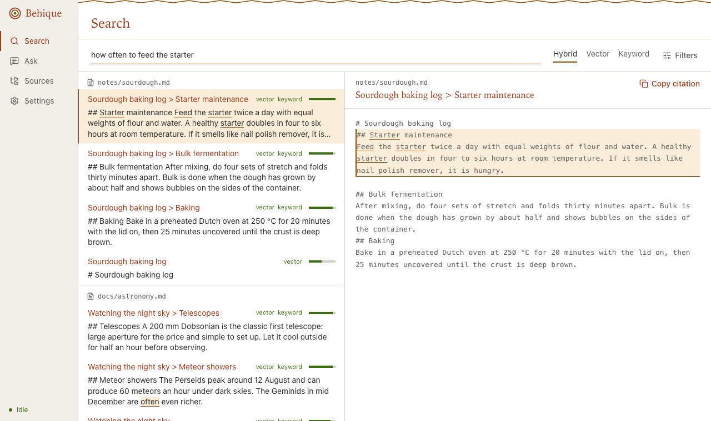
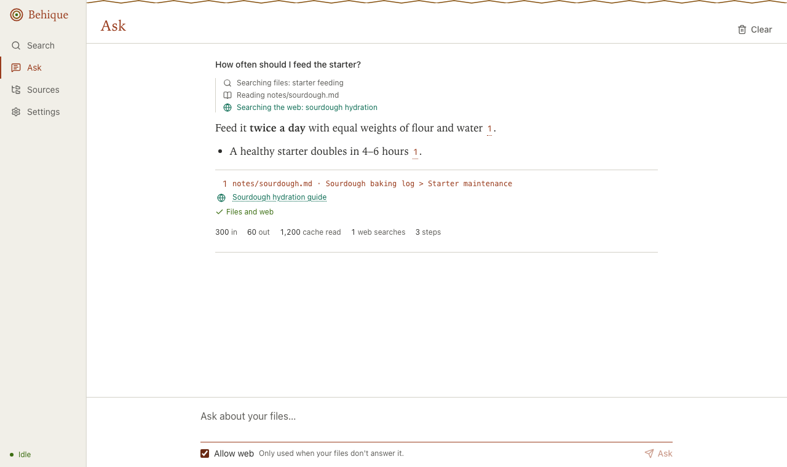

# Behique

Local-first RAG over folders you choose. Behique runs in Docker on your machine, indexes only
the folders you mount (read-only), and gives you:

- **Hybrid search** (local embeddings + BM25, merged with reciprocal rank fusion) over a REST API
- An **MCP endpoint**, so Claude and other agents can search your files
- An opt-in **agentic `/ask`** that answers from your files first and uses the web only when allowed
- A **web UI** at `http://localhost:8000` (Search, Ask, Sources, Settings, ⌘K), served from the
  same container with no external requests

Without an Anthropic API key, nothing leaves the container.

## Quickstart

```sh
git clone https://github.com/Joshua-Rivera/Behique && cd Behique
NOTES_DIR=~/Documents/notes docker compose up --build -d   # mounts it at /data/notes (read-only)

curl localhost:8000/api/health
curl -X POST localhost:8000/api/sources -H 'content-type: application/json' \
     -d '{"name": "notes", "path": "notes"}'
curl -X POST localhost:8000/api/index
curl localhost:8000/api/index/status
curl -X POST localhost:8000/api/search -H 'content-type: application/json' \
     -d '{"query": "how long is the train to Porto", "k": 5}'
```

To index more folders, add more read-only mounts under `/data` in `docker-compose.yml`. A
prebuilt image (amd64 and arm64) is published at `ghcr.io/joshua-rivera/behique`.

Without Docker: `uv sync && DATA_ROOT=~/notes DB_PATH=./behique.db make run`.

## Web UI

Open **http://localhost:8000**. Add a mounted folder on **Sources**, then search or ask.



- **Search**: Hybrid, Vector or Keyword, filters, a resizable preview with the matching chunk
  highlighted, and "Copy citation" (`path:lines`). ↑/↓ move through results.
- **Ask**: streams a step timeline, then a Markdown answer with citation chips: clay for your
  files (opens the preview), sea green for web pages. Shows tokens, cache reads and steps.
- **Sources**: lists mounted folders, adds them, and shows live indexing progress.
- **Settings**: API key (session only unless you choose "Remember"), theme, default mode.
- **⌘K / Ctrl+K** from any page jumps to a result or asks about the query.



Panes are resizable (drag, ←/→ on a focused divider, double-click to reset) and remember their
size. Light and dark follow your system unless you choose one. Motion is off under
reduced-motion settings.

Front-end development: `make run` with `DEV_CORS=true`, then
`cd web && NEXT_PUBLIC_API_BASE=http://localhost:8000 pnpm dev`. After API changes run
`pnpm gen:api`. Tests: `pnpm test` (unit) and `pnpm e2e` (Playwright + axe, against a running
server with a folder mounted).

**Design.** The earthy palette and the concentric-circle and zigzag motifs are abstract shapes
inspired by Taíno art. No figures or petroglyphs are reproduced.

## Use it from Claude (MCP)

```sh
claude mcp add --transport http behique http://localhost:8000/mcp
```

Tools: `search_files`, `read_file`, `list_sources`. All are read-only. If you set `API_KEY`, add
`--header "x-api-key: $API_KEY"`.

## Ask questions (`/ask`)

```sh
ANTHROPIC_API_KEY=sk-ant-... docker compose up -d
curl -X POST localhost:8000/api/ask -H 'content-type: application/json' \
     -d '{"question": "What did the Portugal trip cost?"}'
```

The response has `answer`, `citations` (local chunks and web URLs) and `usage` (input, output,
and cache-read tokens, web searches, steps). `/ask` returns 503 when no key is set.

Claude searches locally first, reads full chunks only when a snippet isn't enough, and stops
when it can answer. Web search and fetch are available only with `ALLOW_WEB=true`. A request
can pass `"allow_web": false` to turn them off, but cannot turn them on.

## Architecture

```mermaid
flowchart LR
  subgraph container[Docker container]
    direction LR
    D[/data, read-only mounts/] --> S[scan + deny-list]
    S --> X[extract: md, txt, code, pdf, docx]
    X --> C[chunk: headings, tree-sitter symbols, token packing]
    C --> E[embed: bge-small-en-v1.5, local]
    E --> DB[(SQLite: chunks + FTS5 + sqlite-vec)]
    DB --> Q[search: vector + BM25 -> RRF]
    Q --> SV[service layer]
    SV --> R[REST API]
    SV --> M[MCP /mcp]
    SV --> A[/ask agent]
  end
  A -. only with ANTHROPIC_API_KEY .-> CL[(Claude API)]
```

- **Chunking** respects structure: Markdown sections carry their heading path (`Guide > Install`),
  and code is split at definitions using tree-sitter (`Widget.spin`). Chunks are sized with the
  embedding model's own tokenizer (400 tokens by default, 15% overlap, never more than 510).
- **Change detection** is a periodic rescan using mtime and size, then a sha256 check. Rescans
  never re-embed a file whose content hasn't changed. File watchers were rejected because
  they're unreliable on Docker for Mac and Windows bind mounts.
- **No framework.** The pipeline is about 1,500 lines of plain Python, so every step can be
  read and explained.

## Retrieval quality

`make eval` indexes `eval/corpus` (12 files) and scores 25 questions at file level. CI fails if
hybrid hit@5 drops below `eval/baseline.json`.

| mode   | hit@5 | MRR   |
|--------|-------|-------|
| vector | 1.000 | 0.980 |
| bm25   | 1.000 | 0.947 |
| hybrid | 1.000 | 1.000 |

Hybrid wins on ranking. BM25 catches exact identifiers (`retry_with_backoff`), and vectors catch
paraphrases ("rail journey between Portuguese cities").

## `/ask` cost

`eval/ask_eval.py` runs 10 questions against the corpus with a real key. It records correctness,
citations and tokens per question. To compare models:

```sh
ANTHROPIC_API_KEY=... uv run python eval/ask_eval.py
ANTHROPIC_API_KEY=... ASK_MODEL=claude-haiku-5-5 uv run python eval/ask_eval.py
```

| model | effort | correct | cited | avg input tokens | avg output tokens |
|---|---|---|---|---|---|
| claude-opus-5-5 | low | _run ask_eval.py_ | | | |
| claude-haiku-5-5 | low | _run ask_eval.py_ | | | |

## Privacy and security

- Behique only sees folders you mount, and they are mounted read-only. The container's root
  filesystem is read-only too, it runs as a non-root user, and it drops all capabilities.
- The API is published on `127.0.0.1` only. Set `API_KEY` to require `x-api-key` (or
  `Authorization: Bearer`) on every REST and MCP request. The MCP endpoint also rejects
  non-localhost `Host` and `Origin` headers, to block DNS rebinding.
- Secrets and noise are never indexed: `.env*`, keys and certificates, `credentials*`,
  `*secret*`, hidden directories, `node_modules`, `.git`, lockfiles. Symlinks are never followed.
- Files are read through `/api/files/{id}`, by id only, never by a path you supply.
- The UI loads nothing from the internet (no fonts, CDNs or analytics) and is served with a
  strict Content-Security-Policy. File and web content is shown as text or sanitized Markdown.
  Your API key stays in the tab's session storage unless you tick "Remember on this device".
- **What leaves your machine:** nothing, unless `ANTHROPIC_API_KEY` is set. With it, `/ask`
  sends your question and the snippets Claude retrieves to the Anthropic API. With
  `ALLOW_WEB=true`, Claude can also search the web.
- **Residual risk:** a malicious document in your folders could try to get Claude to leak file
  content through a web query. Web access is off by default; if you enable it, narrow it with
  `WEB_ALLOWED_DOMAINS` or `WEB_BLOCKED_DOMAINS`.

## Configuration

| Variable | Default | |
|---|---|---|
| `DATA_ROOT` | `/data` | Sources must live under this path |
| `DB_PATH` | `/index/behique.db` | SQLite index |
| `API_KEY` | unset | Require this key on every request |
| `CHUNK_TOKENS` / `OVERLAP` | `400` / `0.15` | Chunk size and window overlap |
| `RESCAN_SECONDS` | `300` | `0` disables the periodic rescan |
| `MAX_FILE_BYTES` | 10 MB | Larger files are skipped |
| `ANTHROPIC_API_KEY` | unset | Enables `/ask` |
| `ASK_MODEL` / `ASK_EFFORT` | `claude-opus-5-5` / `low` | Runtime model for `/ask` |
| `ASK_MAX_STEPS` | `6` | Hard cap on agent steps |
| `ASK_TASK_BUDGET` | unset | Optional token budget (min 20,000) |
| `ALLOW_WEB` | `false` | Allow web search and fetch in `/ask` |
| `WEB_DIR` | `/app/web` | Built UI to serve at `/` (skipped if missing) |
| `DEV_CORS` | `false` | Allow `http://localhost:3000` for `pnpm dev` |
| `WEB_ALLOWED_DOMAINS` / `WEB_BLOCKED_DOMAINS` | unset | Comma-separated; use one |

## API

| Endpoint | |
|---|---|
| `GET /api/health` | `{ok, model, chunks}` |
| `POST /api/sources` `{name, path}` | Register a mounted folder |
| `GET /api/sources` | Sources with file and chunk counts |
| `GET /api/mounts` | Folders under `DATA_ROOT` you can register |
| `POST /api/index` `{source_id?}` | Start a background run (409 if one is running) |
| `GET /api/index/status` | Progress counters and recent errors |
| `POST /api/search` `{query, k, mode, source_id?, ext?, path_prefix?}` | Ranked chunks |
| `GET /api/files/{file_id}?chunk_id=&context=` | File text, or a chunk with neighbours |
| `POST /api/ask` `{question, allow_web?, source_id?}` | Agentic answer with citations and usage |
| `POST /api/ask/stream` | Same, as Server-Sent Events: `step`, `delta`, `citations`, `usage`, `done`, `error` |

Interactive docs are at `http://localhost:8000/docs`.

## Development

```sh
uv sync
make lint test eval
```

See [CONTRIBUTING.md](CONTRIBUTING.md) for the branch and PR workflow, and
[docs/PLAN.md](docs/PLAN.md) for the design. `Research/` holds the study notes behind the project.

## License

MIT
